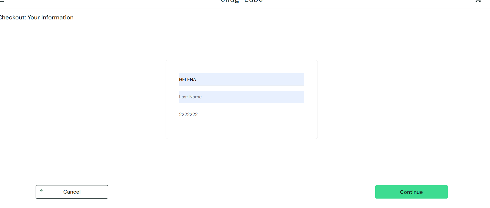
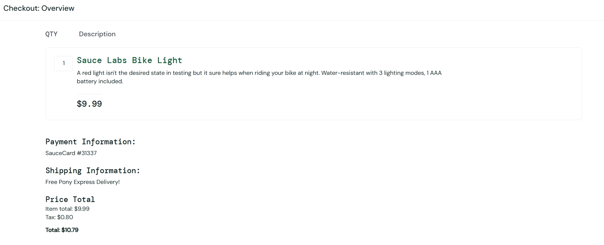
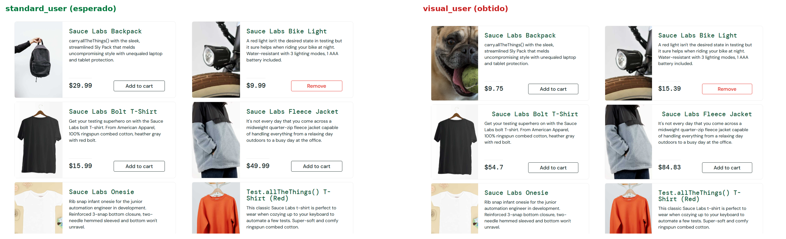

# Relatórios de bug: Sauce Demo

Ambiente de todos os bugs: Google Chrome, Windows, https://www.saucedemo.com. Os casos de teste de origem estão em [casos-de-teste.md](casos-de-teste.md).

| ID | Título | Severidade | Prioridade |
|---|---|---|---|
| BUG-001 | Imagens dos produtos não correspondem aos itens (`problem_user`) | Média | Média |
| BUG-002 | Sobrenome digitado vai para o campo Nome no checkout (`problem_user`) | Alta | Alta |
| BUG-003 | Ordenação de produtos não funciona (`problem_user`) | Média | Média |
| BUG-004 | Campo Last Name não aceita digitação e checkout avança sem validação (`error_user`) | Alta | Alta |
| BUG-005 | Login mais lento que o esperado (`performance_glitch_user`) | Baixa | Baixa |
| BUG-006 | Imagem e preços diferentes do `standard_user` (`visual_user`) | Média | Média |
| BUG-007 | Títulos de produtos desalinhados (`visual_user`) | Baixa | Baixa |
| BUG-008 | Checkout permite finalizar com carrinho vazio (`standard_user`) | Média | Média |

---

## BUG-001: Imagens dos produtos não correspondem aos itens (`problem_user`)

- **Caso de teste:** TC-USR-01
- **Pré-condição:** logar com `problem_user` e `secret_sauce`
- **Passos:**
  1. Acessar o site.
  2. Logar com `problem_user`.
  3. Na lista de produtos, comparar a imagem de cada item com o seu nome e com a lista do `standard_user`.
- **Resultado esperado:** cada produto mostra a imagem do próprio item.
- **Resultado obtido:** todos os produtos exibem a mesma imagem (cachorro com bolinha de tênis). Com o `standard_user`, cada produto exibe a sua imagem correta.
- **Severidade:** Média, pois atrapalha a compreensão do produto, mas não bloqueia a compra.
- **Prioridade:** Média.
- **Status:** Aberto.

## BUG-002: Sobrenome digitado vai para o campo Nome no checkout (`problem_user`)

- **Caso de teste:** TC-USR-03
- **Pré-condição:** logar com `problem_user` e `secret_sauce`, com 1 produto no carrinho
- **Passos:**
  1. Abrir o carrinho e clicar em Checkout.
  2. Preencher First Name.
  3. Digitar no campo Last Name.
  4. Preencher Postal Code e clicar em Continue.
- **Resultado esperado:** cada valor fica no seu campo e o checkout avança.
- **Resultado obtido:** o texto digitado em Last Name é gravado no campo First Name, e Last Name permanece vazio. Ao clicar em Continue, o site exibe o erro `Last Name is required`.
- **Severidade:** Alta, pois impede a conclusão da compra.
- **Prioridade:** Alta.
- **Status:** Aberto.

## BUG-003: Ordenação de produtos não funciona (`problem_user`)

- **Caso de teste:** TC-USR-04
- **Pré-condição:** logar com `problem_user` e `secret_sauce`
- **Passos:**
  1. Na lista de produtos, abrir o filtro de ordenação.
  2. Selecionar, uma de cada vez, as quatro opções: Name (A to Z), Name (Z to A), Price (low to high) e Price (high to low).
- **Resultado esperado:** a lista é reordenada conforme a opção, como no `standard_user`.
- **Resultado obtido:** a ordem dos produtos não muda em nenhuma das opções. A lista permanece igual à original.
- **Severidade:** Média, pois dificulta a busca de produtos, mas não impede a compra.
- **Prioridade:** Média.
- **Status:** Aberto.

## BUG-004: Campo Last Name não aceita digitação e checkout avança sem validação (`error_user`)

- **Caso de teste:** TC-USR-05
- **Pré-condição:** logar com `error_user` e `secret_sauce`, com 1 produto no carrinho
- **Passos:**
  1. Abrir o carrinho e clicar em Checkout.
  2. Preencher First Name.
  3. Tentar preencher Last Name.
  4. Preencher Postal Code e clicar em Continue.
- **Resultado esperado:** o campo Last Name aceita o texto digitado. Se estiver vazio, o site bloqueia o avanço com o erro `Last Name is required`, como no `standard_user`.
- **Resultado obtido:** o campo Last Name não aceita o texto digitado e permanece vazio. Mesmo assim, ao clicar em Continue, o sistema avança para o Checkout: Overview, sem exibir mensagem de erro. São dois defeitos: o campo não aceita digitação e a validação do campo obrigatório não é aplicada.
- **Severidade:** Alta, pois permite concluir a compra sem um dado obrigatório.
- **Prioridade:** Alta.
- **Evidência:**

  

  

- **Status:** Aberto.

## BUG-005: Login mais lento que o esperado (`performance_glitch_user`)

- **Caso de teste:** TC-USR-06
- **Pré-condição:** estar na tela de login
- **Passos:**
  1. Logar com `standard_user` e cronometrar o tempo até a lista de produtos aparecer.
  2. Fazer logout.
  3. Logar com `performance_glitch_user` e cronometrar o tempo até a lista de produtos aparecer.
- **Resultado esperado:** tempos comparáveis nos dois logins.
- **Resultado obtido:** o login do `performance_glitch_user` levou cerca de 4 segundos a mais que o do `standard_user`.
- **Severidade:** Baixa, pois o login funciona, mas com demora perceptível.
- **Prioridade:** Baixa.
- **Status:** Aberto.

## BUG-006: Imagem e preços diferentes do `standard_user` (`visual_user`)

- **Caso de teste:** TC-USR-07
- **Pré-condição:** logar com `visual_user` e `secret_sauce`
- **Passos:**
  1. Logar com `visual_user` e abrir a lista de produtos.
  2. Logar com `standard_user` e abrir a lista de produtos.
  3. Comparar imagens e preços dos itens.
- **Resultado esperado:** mesmas imagens e mesmos preços nos dois usuários.
- **Resultado obtido:**

  | Produto | `standard_user` | `visual_user` |
  |---|---|---|
  | Sauce Labs Backpack | \$29.99 | \$9.75 |
  | Sauce Labs Bike Light | \$9.99 | \$15.39 |
  | Sauce Labs Bolt T-Shirt | \$15.99 | \$54.7 (sem o segundo decimal) |
  | Sauce Labs Fleece Jacket | \$49.99 | \$84.83 |

  A imagem do Backpack também é diferente: no `visual_user`, aparece a foto de um cachorro com bolinha de tênis, em vez da foto da mochila.
- **Severidade:** Média, pois exibe preços incorretos ao cliente. Não foi verificado se o valor errado chega ao total do checkout.
- **Prioridade:** Média.
- **Evidência:**

  

- **Status:** Aberto.

## BUG-007: Títulos de produtos desalinhados (`visual_user`)

- **Caso de teste:** TC-USR-07
- **Pré-condição:** logar com `visual_user` e `secret_sauce`
- **Passos:**
  1. Logar com `visual_user` e abrir a lista de produtos.
  2. Observar o alinhamento dos títulos dos produtos e comparar com o `standard_user`.
- **Resultado esperado:** títulos alinhados à esquerda, junto à descrição, como no `standard_user`.
- **Resultado obtido:** os títulos do Sauce Labs Bolt T-Shirt e do Sauce Labs Fleece Jacket aparecem deslocados para a direita, desalinhados do texto da descrição.
- **Severidade:** Baixa, pois é um defeito apenas visual.
- **Prioridade:** Baixa.
- **Evidência:** ver a [comparação lado a lado](evidencias/BUG-006-007-visual_user-lado-a-lado.png).
- **Status:** Aberto.

## BUG-008: Checkout permite finalizar com carrinho vazio (`standard_user`)

- **Caso de teste:** TC-CHK-07
- **Pré-condição:** logar com `standard_user` e `secret_sauce`, sem itens no carrinho
- **Passos:**
  1. Abrir o carrinho vazio.
  2. Clicar em Checkout.
  3. Preencher nome, sobrenome e CEP e clicar em Continue.
- **Resultado esperado:** o site não permite finalizar uma compra sem itens e exibe uma mensagem de bloqueio.
- **Resultado obtido:** o sistema avança até o Checkout: Overview com Item total \$0, Tax \$0.00 e Total \$0.00, com o botão Finish habilitado. Nenhuma mensagem de bloqueio é exibida.
- **Severidade:** Média, pois permite gerar pedido vazio.
- **Prioridade:** Média.
- **Status:** Aberto.
